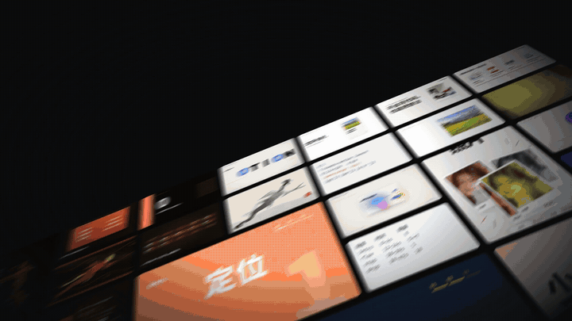
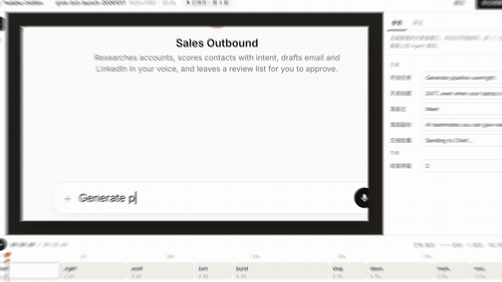
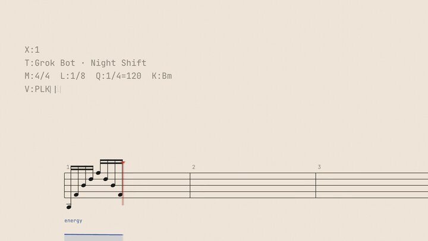
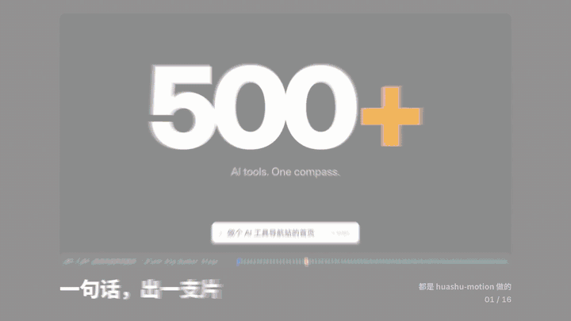

<div align="center">



# huashu-motion · bản tiếng Việt

**Để agent lập trình của bạn làm phim hoạt họa, tự soạn nhạc, và sửa đúng chỗ bạn chỉ trên khung hình.**

[](LICENSE)
[](https://agentskills.io)
[](#cần-những-gì)

```sh
npx skills add mrtinhnguyen/huashu-motion
```

[Nó làm gì](#nó-làm-gì) · [Cài đặt](#cài-đặt) · [Tiếng Việt](#hỗ-trợ-tiếng-việt) · [Cách hoạt động](#cách-hoạt-động) · [Lệnh](#lệnh-thường-dùng) · [Giấy phép](#nguồn-gốc-và-giấy-phép)

</div>

---

## Nó làm gì

Bạn nói với Claude Code, Codex hay một agent tương tự: *“Làm cho sản phẩm của mình một phim ra mắt 30 giây, website là xxx.vn”*. Agent sẽ:

1. đọc sản phẩm của bạn trước (website, giao diện, logo, màu thương hiệu), thu tư liệu thật vào dự án;
2. đưa ra ba hướng, mỗi hướng có khung hình chính, để bạn chọn;
3. viết bảng nhịp, viết cả phim bằng code, tự soạn bản nhạc làm nhạc nền và gắn hiệu ứng âm thanh;
4. mở một trình chỉnh sửa trong trình duyệt. Chỗ nào chưa ưng, bạn bấm vào chỗ đó trên khung hình và ghi một câu, agent chỉ sửa đúng chỗ ấy.



Nhấn **C**, bấm vào khung hình, ghi điều muốn sửa. Bình luận gửi đi kèm mốc thời gian, cảnh, phần tử bạn bấm và vị trí của nó trong mã nguồn. Mọi phiên bản đều được giữ, ⌘Z/Ctrl+Z để hoàn tác. Tiêu đề, con số, màu, thời lượng hiện thành ô nhập bên phải để bạn tự sửa mà không cần chờ agent.

Một vài việc bạn có thể giao:

| Bạn nói | Agent làm |
|---|---|
| “Làm phim ra mắt 30 giây cho app của mình” | Đọc sản phẩm, đưa ba hướng, viết phim, soạn nhạc, mở trình chỉnh sửa |
| “Biến `data/doanh-thu.csv` thành video giải thích 30 giây” | Kể chuyện bằng dữ liệu: trục trước, số liệu sau, chỉ làm nổi một điều |
| “Có lời dẫn, dùng giọng thu của mình: `giong-doc.m4a`” | Căn khớp từng từ, hình rơi đúng vào từ đang nói, tự tạo phụ đề, nhạc nền nhỏ lại khi có giọng |
| “Làm đồ họa cho video nói chuyện này” | Thanh tên, thẻ số liệu, chữ nhấn cho từ khóa, xuất lớp phủ nền trong suốt cho CapCut hoặc Premiere |
| “Đổi sang khổ dọc cho TikTok/Reels” | Nhân bản thành bản 1080×1920 rồi dàn lại bố cục |
| “Xuất GIF” · “Cần nền trong suốt” · “Làm trang web để chia sẻ” | MP4, MOV (trong suốt), WebM, GIF, hoặc một trang chia sẻ có trình phát và mã nguồn |

<table><tr>
<td width="50%"><br/>Viết bản nhạc trước, dựng hình theo phách</td>
<td width="50%"><br/>16 cảnh quay từ bảy phim, cắt theo phách</td>
</tr></table>

*Các đoạn hoạt họa minh họa trong README được làm bằng huashu-motion ở dự án gốc.*

---

## Cài đặt

**Cách 1: nhờ agent cài**

```
Cài giúp mình skill huashu-motion từ github.com/mrtinhnguyen/huashu-motion, cài xong chạy thử demo một lượt
```

**Cách 2: một dòng lệnh**

```sh
npx skills add mrtinhnguyen/huashu-motion
```

[skills](https://github.com/vercel-labs/skills) tự nhận ra agent bạn đang dùng và đặt skill vào đúng thư mục; muốn chỉ định thì thêm `-a claude-code` hoặc `-a codex`. Agent nào hỗ trợ chuẩn [Agent Skills](https://agentskills.io) đều dùng được.

**Cách 3: clone repo** (sửa repo cũng là sửa skill)

```sh
git clone https://github.com/mrtinhnguyen/huashu-motion.git
ln -s "$PWD/huashu-motion/skills/huashu-motion" ~/.claude/skills/huashu-motion   # Codex: ~/.codex/skills/
```

Trên Windows, thay `ln -s` bằng `mklink /D` (hoặc `New-Item -ItemType SymbolicLink` trong PowerShell).

### Cần những gì

- **Node 22** trở lên.
- **Chrome** (hoặc Chromium, Edge) đã cài sẵn: chụp khung hình, kiểm tra và render đều điều khiển trình duyệt trên máy bạn, không tải thêm trình render nào.
- **FFmpeg**: để xuất video và trộn âm thanh.
- *Tùy chọn* · nhạc cụ thật: `om samples build` tải khoảng 55 MB mẫu âm thanh miễn phí (CC0, CC-BY) cho grand piano, dàn dây, bộ trống; không chạy thì dùng âm tổng hợp.
- *Tùy chọn* · lời dẫn: xem [Hỗ trợ tiếng Việt](#hỗ-trợ-tiếng-việt). Muốn căn khớp từng từ với bản thu của bạn thì cài whisper-cli (whisper.cpp).

Thiếu gì, chạy `om doctor` là biết; agent có thể cài giúp.

---

## Hỗ trợ tiếng Việt

Bản này khác bản gốc ở những điểm sau:

**Tài liệu và skill bằng tiếng Việt.** SKILL.md và toàn bộ tài liệu phương pháp trong `skills/huashu-motion/references/` đã chuyển sang tiếng Việt; ví dụ câu lệnh và nền tảng phân phối (TikTok, Facebook Reels, YouTube Shorts) theo thị trường Việt Nam.

**Font đủ dấu.** Chữ Việt có dấu xếp chồng (Ấ, ỗ, ự…), font thiếu glyph sẽ hiển thị lẫn sang font khác.

- Font sans mặc định **Inter** đã được build lại với đủ dấu tiếng Việt.
- Thêm **Be Vietnam Pro** (500, 700, 800, 900), font không chân thiết kế riêng cho tiếng Việt.
- `om fonts --vi` chỉ liệt kê các họ font đủ dấu: Be Vietnam Pro, Inter, Anton, Bangers, Alfa Slab One, EB Garamond, Cormorant Garamond, Playfair Display, Josefin Sans, Exo 2.
- Với chữ tiêu đề cỡ lớn, để `line-height` từ khoảng 1.3 trở lên để dấu không bị cắt.

**Lời dẫn tiếng Việt.** `om voice <dir> --text kich-ban.txt` tự nhận ra kịch bản tiếng Việt và chọn giọng Việt:

| Hệ điều hành | Giọng mặc định | Cài giọng |
|---|---|---|
| Windows | `win:vi-VN` (Microsoft An) | Settings → Time & language → Speech → Add voices → Vietnamese |
| macOS | `say:Linh` | System Settings → Accessibility → Spoken Content → System voice → Manage voices → Linh |
| Linux | chưa có giọng tích hợp | thu giọng của bạn rồi dùng `--audio <file>` |

- Chọn giọng khác: `--voice win:<tên giọng>` hoặc `--voice say:<tên giọng>`.
- Với bản thu của bạn (`--audio`), whisper được đặt nghe tiếng Việt.
- Từ có dấu được giữ nguyên, mỗi âm tiết tính là một nhịp khi chia thời lượng; phụ đề được ngắt theo độ rộng chữ Latin.
- `OM.cue('không biết')` khớp được cụm nhiều âm tiết, để hình rơi đúng lúc cụm từ được nói.

Một kịch bản tiếng Anh chỉ nhắc một tên riêng tiếng Việt (vd. “Nguyễn”) vẫn được đọc bằng giọng Anh: phải có từ một phần năm số từ trở lên mang dấu tiếng Việt thì mới tính là kịch bản tiếng Việt.

---

## Cách hoạt động

**Mỗi phim là một file `index.html`.** Hình được viết bằng code (GSAP, Canvas, Three.js, SVG), không gọi model tạo video; mỗi khung hình chỉ phụ thuộc vào code và thời gian. Phim chính là một trang web, mang đi đâu cũng dùng được.

```
agent của bạn ──viết──▶ phim/index.html ◀──theo dõi── om studio (trình chỉnh sửa trong trình duyệt)
    ▲                                                     │
    └── om inbox --wait ◀── .om/inbox.jsonl ◀── bạn bấm vào khung hình, ghi một câu
```

**Phương pháp đạo diễn, không phải template.** Phần lớn nhất của skill là cách đạo diễn: đọc sản phẩm, tìm khí chất của nó, rồi mới chọn cấu trúc phim và ngôn ngữ chuyển động. Quy tắc lấy từ đo đạc các phim ra mắt thật (điểm cắt, phách, độ lớn âm thanh, đường cong năng lượng); thư viện có 20 ngôn ngữ chuyển động, mỗi loại ghi rõ nó nói điều gì và hợp với sản phẩm nào. Mỗi phim có bảng nhịp: móc câu trong 3 giây đầu, một lần bùng nổ ở giữa, ngừng một nhịp trước cú mạnh nhất.

**Âm thanh là một nửa bộ phim.** Agent viết bản nhạc (ký âm ABC), chương trình chơi bằng mẫu nhạc cụ, dấu cảnh trong bản nhạc khớp với hình. Có sẵn nhạc nền dự phòng cho nhiều loại sản phẩm và 23 hiệu ứng âm thanh (tiếp đất, lia máy, gõ phím, glitch…). Mọi thứ được tạo ngay trên máy, không gọi API trả phí.

**Render song song.** Nhiều trình duyệt render cùng lúc theo số nhân CPU (mặc định tối đa 8); hình và âm thanh được mã hóa song song.

**Bắt lỗi trước khi giao.**

- `om check`: trước khi render, soát script, file thiếu, cách viết hoạt họa sai quy tắc, chữ bị cắt, bị che, thiếu tương phản.
- `om qa`: soát phim thành phẩm (khung lóe, đoạn chết, cắt cứng, đường cong chuyển động); `--sheet` trải cả phim thành contact sheet để nhìn một lần là thấy đoạn nào giống slide.

---

## Lệnh thường dùng

Bình thường agent gõ hết, nhưng bạn cũng có thể tự chạy (qua `skills/huashu-motion/bin/om`):

| Lệnh | Làm gì |
|---|---|
| `om grab` | Thu tư liệu thật của sản phẩm: ảnh chụp trang, logo, ảnh, màu và font, hoặc từ thư mục dự án |
| `om new` · `om templates` | Tạo dự án mới, có thể bắt đầu từ 12 template |
| `om studio` | Trình chỉnh sửa: xem trước trực tiếp, sửa giá trị, bình luận trên khung hình |
| `om inbox --wait` · `om look` · `om done` | Phía agent: nhận bình luận, xem chỗ bạn bấm, báo lại đã sửa gì |
| `om sound` · `om voice` · `om samples` | Nhạc nền và hiệu ứng, lời dẫn, gói nhạc cụ thật |
| `om fonts [--vi]` · `om fonts add "<font>"` | Xem font đi kèm, thêm font vào dự án |
| `om check` · `om qa` · `om still` | Kiểm tra trước render, kiểm tra thành phẩm, chụp một khung bất kỳ |
| `om render` · `om share` · `om export html` · `om fork` | Xuất file, gói chia sẻ (GIF + nội dung bài đăng), trang chia sẻ, đổi khổ hình |
| `om learn` · `om undo` · `om doctor` | Kinh nghiệm qua các phim, hoàn tác, kiểm tra môi trường |

---

## Bên trong có gì

```
huashu-motion/
├── skills/huashu-motion/   # SKILL.md, tài liệu phương pháp, 20 ngôn ngữ chuyển động, bản nhạc mẫu, kinh nghiệm
├── cli/                    # lệnh om: tạo mới, trình chỉnh sửa, hộp thư, âm thanh, lời dẫn, kiểm tra, render
├── runtime/                # các tiện ích OM.* dùng trong phim, engine render từng khung
├── studio/                 # trình chỉnh sửa trong trình duyệt
├── templates/              # 12 template khởi đầu
├── fonts/                  # font mã nguồn mở đi kèm (SIL OFL 1.1)
├── examples/               # phim mẫu (om demo)
└── test/                   # test: npm test
```

---

## Giới hạn

- **Nó không nghe được.** Agent kiểm tra âm thanh qua bản nhạc, đường cong năng lượng và phổ; lần nghe cuối vẫn là của bạn.
- **Nó không tạo người thật hay cảnh quay thật.** Hình do code vẽ; cần người hay cảnh thật thì dùng tư liệu của bạn.
- **Kết quả phụ thuộc model.** Gu thẩm mỹ giữa các model khác nhau thật.
- **Cần chạy lệnh trên máy.** Xem trước và xuất file cần Node, Chrome và FFmpeg; sandbox của một số agent sẽ chặn trình duyệt hoặc server cục bộ, khi đó phê duyệt thủ công một lần.

---

## Nguồn gốc và giấy phép

Bản này là fork tiếng Việt của **huashu-motion** do Huashu phát triển, phát hành theo giấy phép MIT. Dòng bản quyền gốc được giữ trong [LICENSE](LICENSE).

- Code và tài liệu: MIT.
- Phần bên thứ ba giữ giấy phép riêng: GSAP (GSAP Standard License), font (SIL OFL 1.1, xem [fonts/LICENSES.md](fonts/LICENSES.md)), Kokoro và whisper.cpp được tải ở lần dùng đầu tiên. Chi tiết: [THIRD_PARTY.md](THIRD_PARTY.md).
- Ngoại lệ: nhân vật hoạt hình hạt đậu (phần vẽ nhân vật trong `runtime/clip/lib/toon.js` và hình tượng của nó trong template storytime, phim mẫu) là hình tượng của tác giả gốc, chỉ dùng để minh họa cho dự án này, không được cấp phép MIT cho mục đích khác.
- Phim mẫu mở bằng `om demo` dùng engine vẽ của huashu-art-motion (MIT, xem `runtime/clip/NOTICE.md`).
